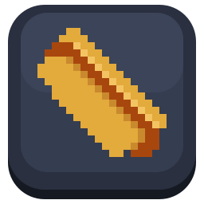
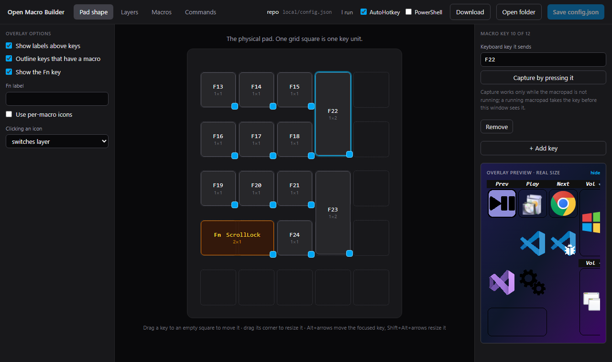
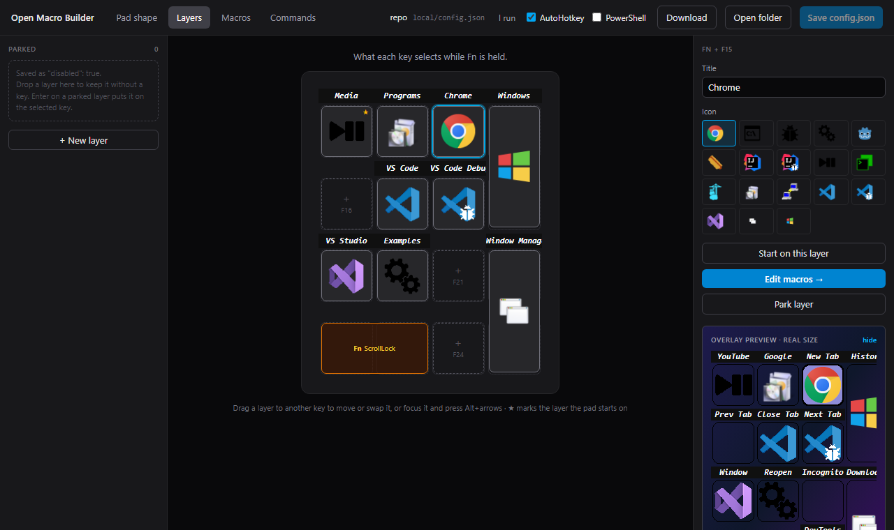
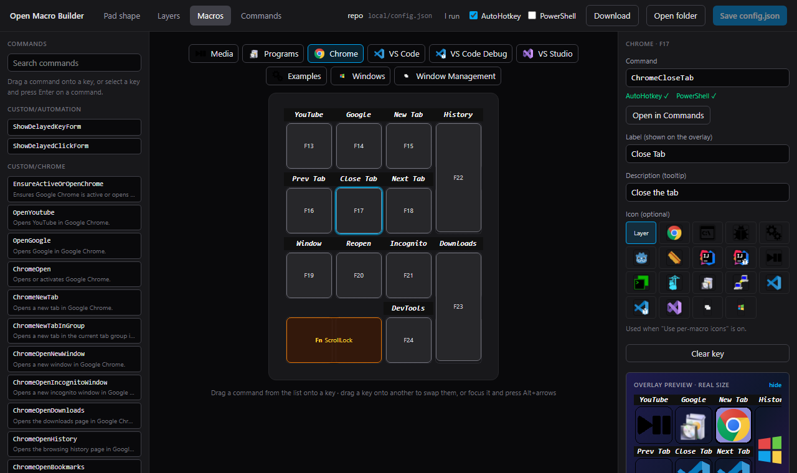
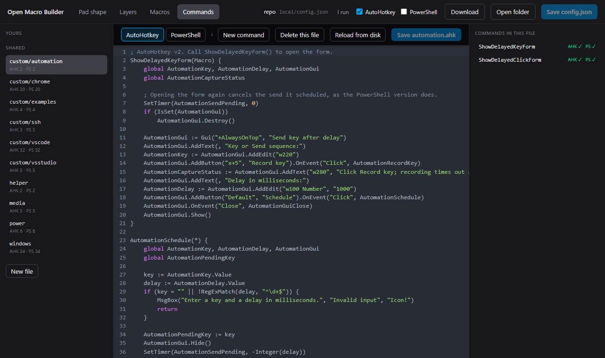

<p align="center">
  
</p>

<h1 align="center">Open Macro Builder</h1>

<p align="center"><em>Build your perfect macropad, with any keyboard.</em></p>

<p align="center">
  <a href="https://github.com/hotdog-Studio/Open-Macro-Builder/releases/latest"></a>
  <a href="LICENSE"></a>
  
</p>

Turn a spare keypad into layers of macros. Bind its keys to F13 to F24 and pick one key as Fn. Hold Fn to see an overlay of your layers and tap a key to choose one. Let go, and each key runs the macro in its slot of that layer.


- **Any keyboard.** Anything that can send F13 to F24 works: a numpad, a QMK or VIA board, a remapped spare keyboard.
- **Two versions, one layout.** Run it with AutoHotkey v2, or with the PowerShell that is already in Windows and install nothing.
- **A visual configurator.** Draw the pad, arrange layers and drop commands onto keys, in a desktop app or in the browser.
- **Yours stays yours.** Your layout and commands live in one git-ignored folder.

## Contents

- [Get it](#get-it)
- [Getting started](#getting-started)
- [Configurator](#configurator)
- [The layout file](#the-layout-file)
- [Commands](#commands)
- [Your own layout and commands](#your-own-layout-and-commands)
- [For developers](#for-developers)
- [AI assistance](#ai-assistance)
- [License](#license)

## Get it

The macropad runs from a copy of this repository, so start with that:

```
git clone https://github.com/hotdog-Studio/Open-Macro-Builder.git
```

Or download the source of the [latest release](https://github.com/hotdog-Studio/Open-Macro-Builder/releases/latest) and unzip it.

The configurator, which edits the layout in that folder, comes three ways:

| | Where | Notes |
| --- | --- | --- |
| **Desktop app** (Windows) | [Releases](https://github.com/hotdog-Studio/Open-Macro-Builder/releases/latest): `Open-Macro-Builder-Setup-<version>.exe`, or the portable `.exe` | Can also reload the running macropad after a save, and checks a command file's syntax. |
| **Docker image** | `ghcr.io/hotdog-studio/open-macro-builder` | The browser version on a small web server. See [docs/docker.md](docs/docker.md). |
| **From source** | `cd configurator && npm install && npm run dev` | See [docs/development.md](docs/development.md). |

The desktop app is unsigned, so Windows SmartScreen asks for confirmation on the first run: choose **More info**, then **Run anyway**.

## Getting started

| Folder | Runs on | Notes |
| --- | --- | --- |
| `ahk/` | [AutoHotkey v2](https://www.autohotkey.com/download/) | The original version. |
| `powershell/` | Windows PowerShell 5.1, built into Windows | Nothing to install. See [powershell/README.md](powershell/README.md). |

Both read the same layout file, use the same icons in `img/` and have the same command names, so you can switch between them without touching your layout. Run one at a time: both claim the macro keys.

1. Set your keypad's keys to send F13 to F24, with whatever tool your keypad uses. `qmk/` has the VIA/QMK layout of the EPOMAKER EK21 this was built for.
2. Copy the example `config.json` to `local/config.json` and edit it, by hand or with the [configurator](#configurator). The `local/` folder is yours: git ignores it (see [Your own layout and commands](#your-own-layout-and-commands)).
3. **AutoHotkey:** install AutoHotkey v2, then run `ahk/main.ahk`. **PowerShell:** run `wscript powershell\launch.vbs`.

To start either one with Windows, point a shortcut in `shell:startup` at `ahk\main.ahk` or at `launch.vbs` (powershell/README.md has the steps).

## Configurator

A visual editor for the layout (the pad shape, the layers and the macros) and for the command files in both languages. Press **Open folder** and pick your copy of this repository. It edits `local/config.json` when that exists, else the example `config.json`, and offers to make the copy for you the first time. It ignores `OMB_CONFIG`.

| Pad shape | Layers |
| --- | --- |
|  |  |
| Place and size the keys of your pad. | Choose which layer each key selects while Fn is held. |

| Macros | Commands |
| --- | --- |
|  |  |
| Drag commands onto the keys of a layer. | Read and edit the command files, in AutoHotkey and PowerShell. |

Everything you can drag you can also do from the keyboard:

| Keys | On | Does |
| --- | --- | --- |
| <kbd>Alt</kbd> + arrow | a key on Pad shape | moves it one square |
| <kbd>Shift</kbd> + <kbd>Alt</kbd> + arrow | a key on Pad shape | resizes it |
| <kbd>Alt</kbd> + arrow | a key on Layers or Macros | swaps its layer or macro with the key beside it |
| <kbd>Enter</kbd> | a command, or a parked layer | puts it on the selected key |

In a browser it needs Chrome or Edge: Firefox and Safari can't open folders, so they can't run it.

## The layout file

Both versions load the first of these that exists: the file named by the `OMB_CONFIG` environment variable, `local/config.json`, then the example `config.json`.

```json
{
  "fn": { "key": "ScrollLock", "row": 4, "col": 1, "width": 2 },
  "keys": [
    { "key": "F13", "row": 1, "col": 1 },
    { "key": "F14", "row": 1, "col": 2 },
    { "key": "F22", "row": 1, "col": 4, "height": 2 }
  ],
  "layers": [
    {
      "title": "Media",
      "icon": "media",
      "macros": [
        { "action": "PlayPause", "name": "Play", "description": "Play or pause" },
        null,
        { "action": "VolumeUp", "name": "Vol +" }
      ]
    },
    null,
    { "title": "Spare", "icon": "default_commands", "disabled": true, "macros": [] }
  ],
  "default": 1,
  "showFn": " ",
  "showMacroMarkers": true,
  "showLabels": true,
  "useMacroIcons": false,
  "iconAction": "Layer",
  "hotkeys": [],
  "hotstrings": []
}
```

- `fn` is the key you hold to choose a layer. `keys` are the macro keys, placed on a grid by `row` and `col`, with `width` and `height` in keys (default 1).
- Layers and macros are matched to keys by position: the first layer belongs to the first key, and so on. `null` leaves a slot empty. `"disabled": true` keeps a layer in the file without giving it a key.
- `icon` names a folder in `img/` holding `layer.png`, `macro.png`, `selected.png` and `selected_macro.png`.
- `action` names a command function. `name` is the label shown above the key, and `description` is its tooltip.
- `default` is the layer selected at startup, counted from 1. `showFn` is the text above the Fn key. `showMacroMarkers` marks keys that have a macro on the selected layer, and `showLabels` shows the macro names. `useMacroIcons` and `iconAction` change what the overlay's icons show and do.
- `hotkeys` and `hotstrings` add ordinary AutoHotkey-style hotkeys and hotstrings, such as `{ "hotkey": "^!e", "action": "OpenFileExplorer" }` and `{ "hotstring": "::btw", "replacement": "by the way" }`. powershell/README.md describes the options.

`node scripts/validate-config.mjs` checks the layout both versions would load: its structure, the icon folders, and that every action exists in both versions. Pass a path to check another file.

## Commands

Command functions live in `ahk/commands/` and `powershell/commands/`, with the same names in both. Each takes the macro as its only parameter.

- `helper`, `media`, `power`, `windows`: the core commands.
- `custom/chrome`, `custom/vscode`, `custom/vsstudio`: keyboard shortcuts for Chrome, VS Code and Visual Studio.
- `custom/ssh`: `LoadPuttySession`, `SshMacroName` and `SshMacroDescription` (open the saved PuTTY session named like the macro), and `SshExample`.
- `custom/examples`: small commands to copy from, for opening a website, a program, Calculator or a folder.
- `custom/automation`: forms that send a key or replay a click after a delay.

The example `config.json` uses all of them.

## Your own layout and commands

Everything specific to you lives in `local/`, which git ignores, so your hosts, paths, accounts and layout never reach the repository:

- `local/config.json`: your layout.
- `local/ahk/commands.ahk`: your AutoHotkey commands. `ahk/config.ahk` includes it when it exists; `#Include` your other files from it.
- `local/powershell/commands/*.ps1`: your PowerShell commands, loaded automatically.
- `local/powershell/tests/*.Tests.ps1`: tests for them, which `powershell/tests/run.ps1` runs too.
- `local/denylist.txt`: strings that must never be committed, one per line. [docs/development.md](docs/development.md#keeping-private-details-out-of-git) has the git hooks that enforce it.

## For developers

- [CONTRIBUTING.md](CONTRIBUTING.md): how to propose a change.
- [docs/development.md](docs/development.md): setting up, the repository layout, every test suite and CI.
- [docs/architecture.md](docs/architecture.md): how the configurator is put together.
- [docs/docker.md](docs/docker.md): the Docker images.
- [docs/releasing.md](docs/releasing.md): what a release is made of and how to cut one.
- [CHANGELOG.md](CHANGELOG.md): what changed in each version.

## AI assistance

The original AutoHotkey version was written by hand by the maintainer. Most of what came after was written with [Claude Code](https://claude.com/claude-code), Anthropic's coding assistant, working under the maintainer's direction: the configurator, the PowerShell version, the rework of the AutoHotkey version, the tests and the documentation.

- Every commit Claude took part in says so with a `Co-Authored-By: Claude` line, so `git log --grep="Co-Authored-By: Claude"` lists them.
- Nothing is merged on the assistant's word. Each change has to pass the test suites and the SonarQube quality gate in CI, described in [docs/development.md](docs/development.md).

## License

[GNU General Public License v3](LICENSE). Made by [hotdog Studio](https://hotdog.studio).
