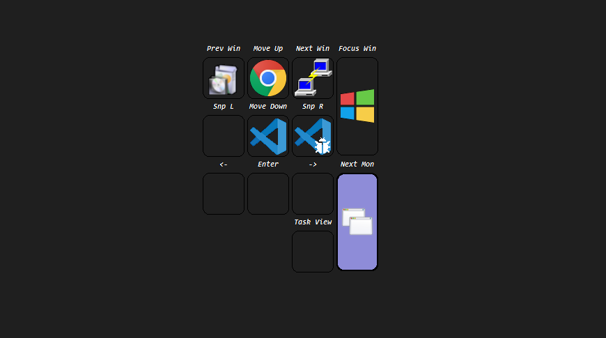

# Open Macro Builder
*Build your perfect macropad, with any keyboard.*

Turn a spare keypad into layers of macros. Bind its keys to F13 to F24 and pick one key as Fn. Hold Fn to see an overlay of your layers and tap a key to choose one. Let go, and each key runs the macro in its slot of that layer.

## Two versions, one config

| Folder | Runs on | Notes |
| --- | --- | --- |
| `ahk/` | [AutoHotkey v2](https://www.autohotkey.com/download/) | The original version. |
| `powershell/` | Windows PowerShell 5.1, built into Windows | Nothing to install. See [powershell/README.md](powershell/README.md). |

Both read the same layout file, use the same icons in `img/` and have the same command names, so you can switch between them without touching your layout. Run one at a time: both claim the macro keys.

## Getting started

1. Copy the example `config.json` to `local/config.json` and edit it. The `local/` folder is yours: git ignores it (see [Your own layout and commands](#your-own-layout-and-commands)).
2. **AutoHotkey:** install AutoHotkey v2, then run `ahk/main.ahk`. **PowerShell:** run `wscript powershell\launch.vbs`.

To start either one with Windows, point the shortcut in `shell:startup` at `ahk\main.ahk` or at `launch.vbs` (powershell/README.md has the steps).

## The layout file

Both versions load the first of these that exists: the file named by the `OMB_CONFIG` environment variable, `local/config.json`, then the example `config.json`.

```json
{
  "fn": { "key": "ScrollLock", "row": 4, "col": 1, "width": 2 },
  "keys": [
    { "key": "F13", "row": 1, "col": 1 },
    { "key": "F14", "row": 1, "col": 2 },
    { "key": "F22", "row": 1, "col": 4, "height": 2 }
  ],
  "layers": [
    {
      "title": "Media",
      "icon": "media",
      "macros": [
        { "action": "PlayPause", "name": "Play", "description": "Play or pause" },
        null,
        { "action": "VolumeUp", "name": "Vol +" }
      ]
    },
    null,
    { "title": "Spare", "icon": "default_commands", "disabled": true, "macros": [] }
  ],
  "default": 1,
  "showFn": " ",
  "showMacroMarkers": true,
  "showLabels": true,
  "useMacroIcons": false,
  "iconAction": "Layer",
  "hotkeys": [],
  "hotstrings": []
}
```

- `fn` is the key you hold to choose a layer. `keys` are the macro keys, placed on a grid by `row` and `col`, with `width` and `height` in keys (default 1).
- Layers and macros are matched to keys by position: the first layer belongs to the first key, and so on. `null` leaves a slot empty. `"disabled": true` keeps a layer in the file without giving it a key.
- `icon` names a folder in `img/` holding `layer.png`, `macro.png`, `selected.png` and `selected_macro.png`.
- `action` names a command function. `name` is the label shown above the key, and `description` is its tooltip.
- `default` is the layer selected at startup, counted from 1. `showFn` is the text above the Fn key. `showMacroMarkers` marks keys that have a macro on the selected layer, and `showLabels` shows the macro names. `useMacroIcons` and `iconAction` change what the overlay's icons show and do.
- `hotkeys` and `hotstrings` add ordinary AutoHotkey-style hotkeys and hotstrings, such as `{ "hotkey": "^!e", "action": "OpenFileExplorer" }` and `{ "hotstring": "::btw", "replacement": "by the way" }`. powershell/README.md describes the options.

`node scripts/validate-config.mjs` checks the layout both versions would load: its structure, the icon folders, and that every action exists in both versions. Pass a path to check another file.

## Commands

Command functions live in `ahk/commands/` and `powershell/commands/`, with the same names in both. Each takes the macro as its only parameter.

- `helper`, `media`, `power`, `windows`: the core commands.
- `custom/chrome`, `custom/vscode`, `custom/vsstudio`: keyboard shortcuts for Chrome, VS Code and Visual Studio.
- `custom/ssh`: `LoadPuttySession`, `SshMacroName` and `SshMacroDescription` (open the saved PuTTY session named like the macro), and `SshExample`.
- `custom/examples`: small commands to copy from, for opening a website, a program, Calculator or a folder.
- `custom/automation`: forms that send a key or replay a click after a delay.

The example `config.json` uses all of them.

## Your own layout and commands

Everything specific to you lives in `local/`, which git ignores, so your hosts, paths, accounts and layout never reach the repository:

- `local/config.json`: your layout.
- `local/ahk/commands.ahk`: your AutoHotkey commands. `ahk/config.ahk` includes it when it exists; `#Include` your other files from it.
- `local/powershell/commands/*.ps1`: your PowerShell commands, loaded automatically.
- `local/powershell/tests/*.Tests.ps1`: tests for them, which `powershell/tests/run.ps1` runs too.
- `local/ci/jenkins.env`: the Jenkins URL and checkout credential id for `ci/create-jenkins-job.sh`.
- `local/denylist.txt`: strings that must never be committed, one per line.

`scripts/check-private.mjs` fails when a deny-listed string would reach git. Run it from git hooks so nothing slips through:

```
printf '#!/bin/sh\nexec node scripts/check-private.mjs --staged\n' > .git/hooks/pre-commit
printf '#!/bin/sh\nexec node scripts/check-private.mjs --pre-push\n' > .git/hooks/pre-push
node scripts/check-private.mjs --history          # check every commit
```

## Configurator

A visual editor for `config.json` (the pad shape, the layers and the macros) and for the command files in both languages. It edits `local/config.json` when that exists, else the example `config.json`. It ignores `OMB_CONFIG`.

```
cd configurator
npm install
npm run dev
```

Open the address it prints in Chrome or Edge, press **Open folder** and pick this repository. Firefox and Safari can't open folders, so they can't run it.

For a desktop app instead of a browser tab, run `npm run electron`. It can also reload the running macropad after you save. The desktop app also checks a command file's syntax when you save it.

To build the desktop app for Windows, run `npm run dist` in `configurator/`. It writes two files into `configurator/release/`, which git ignores:

- `Open Macro Builder Setup 0.1.0.exe`: an installer that lets you choose the install folder.
- `Open Macro Builder 0.1.0 portable.exe`: one file you can run from anywhere, with no install.

The app is unsigned, so Windows SmartScreen asks for confirmation on the first run: choose **More info**, then **Run anyway**. The packaged app opens any Open Macro Builder folder you pick, exactly as `npm run electron` does.

## Repository layout

- `config.json`: the example layout.
- `ahk/`: the AutoHotkey version (`main.ahk`, `lib/`, `commands/`, `tests/`).
- `powershell/`: the PowerShell version, its tests and its docs.
- `img/`: icon sets, one folder per icon.
- `qmk/`: the VIA/QMK layout of the EPOMAKER EK21 keypad this was built for.
- `scripts/`: the config validator, the private-details check and their tests.
- `configurator/`: the web and desktop configurator (React, Vite, TypeScript, Electron). See [Configurator](#configurator).
- `Jenkinsfile`, `sonar-project.properties`, `ci/`: CI and the Jenkins job definition.
- `local/`: yours, ignored by git.

## Tests and CI

```
node --test "scripts/*.test.mjs"                          # validator and private-details check
cd configurator && npm install && npm test                # configurator (Vitest); also npm run lint and npm run build
powershell -NoProfile -File powershell\tests\run.ps1      # Pester suite (Windows)
```

Jenkins validates `config.json`, runs the script tests, then installs, lints, tests and builds the configurator on the Linux agent (without the Electron binary, which it never starts). It runs the Pester suite on a Windows agent when the `OMB_WINDOWS_LABEL` global names one, then sends everything to SonarQube and waits for the quality gate. The `Jenkinsfile` header lists the globals, such as `OMB_NTFY_URL` for build notifications.

The Jenkins job is a multibranch pipeline defined in `ci/jenkins-job.xml`. It checks out over SSH and scans for new commits every 2 minutes. To create it, or update it after editing the XML, put `JENKINS_URL` and `JENKINS_CREDENTIALS_ID` in `local/ci/jenkins.env` and run:

```
JENKINS_USER=<user> JENKINS_TOKEN=<api token> sh ci/create-jenkins-job.sh
```

The first analysis creates the SonarQube project `hotdog-Studio_open-macro-builder` if the Jenkins token may create projects. Otherwise, create it in SonarQube first.

## Showcase

### Example with Numpad


## License

See [LICENSE](LICENSE).
