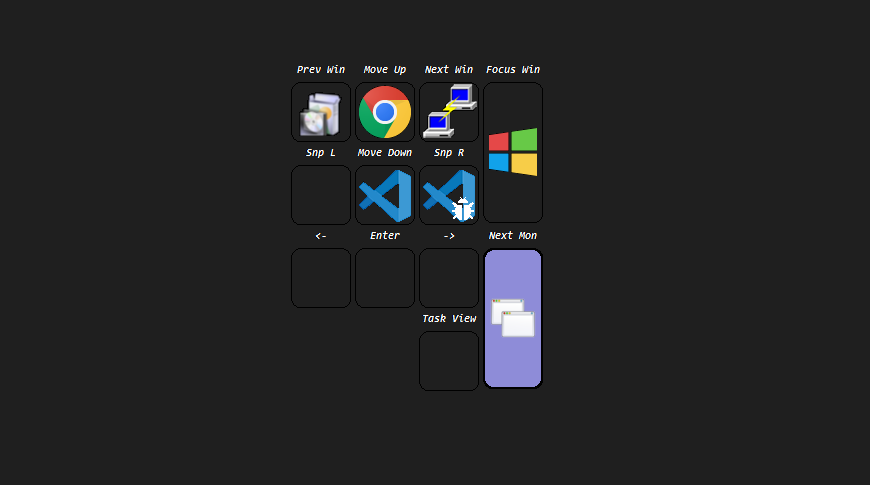
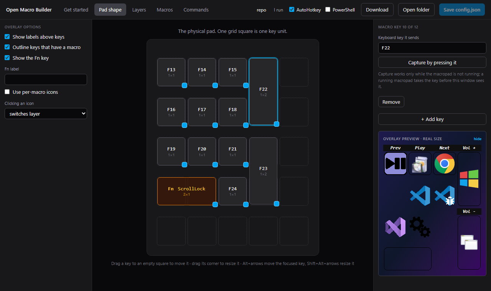
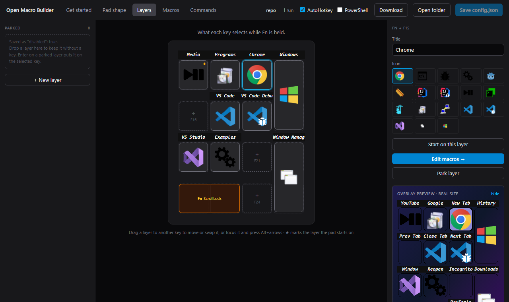
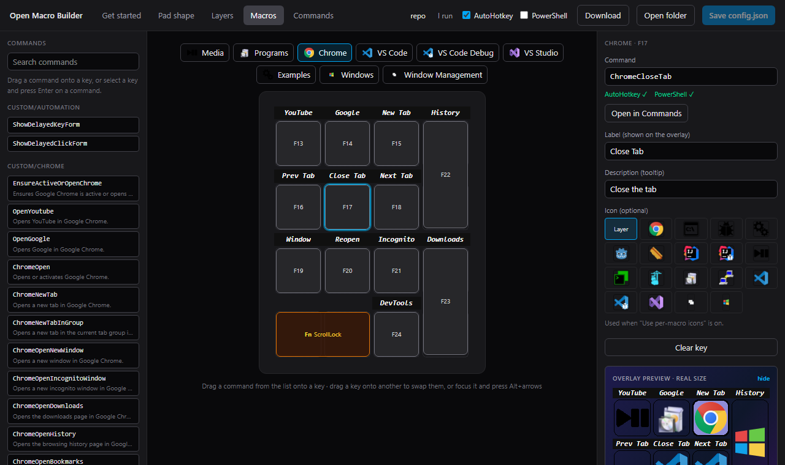
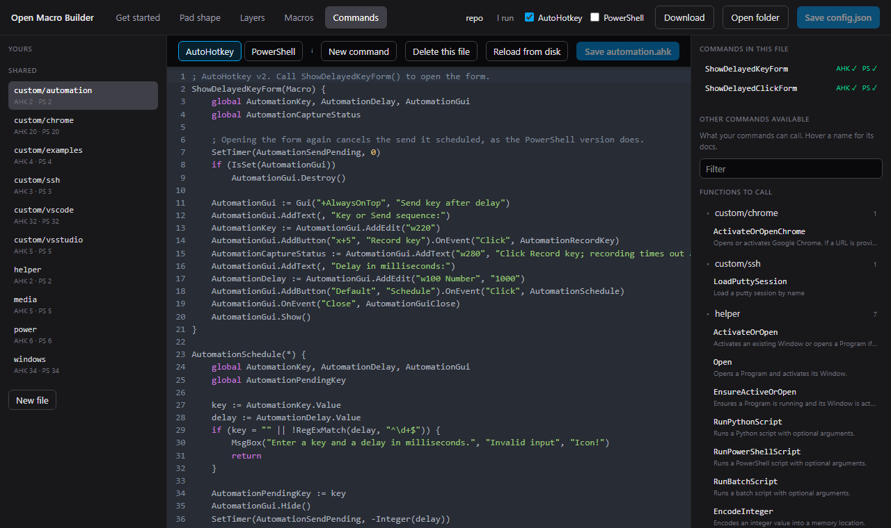

<p align="center">
  
</p>

<h1 align="center">Open Macro Builder</h1>

<p align="center"><em>Build your perfect macropad, with any keyboard.</em></p>

<p align="center">
  <a href="https://github.com/hotdog-Studio/Open-Macro-Builder/releases/latest"></a>
  <a href="LICENSE"></a>
  
</p>

Turn a spare keypad into layers of macros. Bind its keys to F13 to F24 and pick one key as Fn. Hold Fn to see an overlay of your layers and tap a key to choose one. Let go, and each key runs the macro in its slot of that layer.



- **Any keyboard.** Anything that can send F13 to F24 works: a numpad, a QMK or VIA board, a remapped spare keyboard.
- **Two versions, one layout.** Run it with AutoHotkey v2, or with the PowerShell that is already in Windows and install nothing.
- **A visual configurator.** Draw the pad, arrange layers and drop commands onto keys, in a desktop app or in the browser.
- **Yours stays yours.** Your layout and commands live in one git-ignored folder.

## Contents

- [Get it](#get-it)
- [Getting started](#getting-started)
- [Configurator](#configurator)
- [The layout file](#the-layout-file)
- [Commands](#commands)
- [Your own layout and commands](#your-own-layout-and-commands)
- [Roadmap](#roadmap)
- [For developers](#for-developers)
- [AI assistance](#ai-assistance)
- [License](#license)

## Get it

The macropad runs from a copy of this repository, so start with that:

```
git clone https://github.com/hotdog-Studio/Open-Macro-Builder.git
```

Or download the source of the [latest release](https://github.com/hotdog-Studio/Open-Macro-Builder/releases/latest) and unzip it.

The configurator, which edits the layout in that folder, comes three ways:

| | Where | Notes |
| --- | --- | --- |
| **Desktop app** (Windows) | [Releases](https://github.com/hotdog-Studio/Open-Macro-Builder/releases/latest): `Open-Macro-Builder-Setup-<version>.exe`, or the portable `.exe` | Can also reload the macropad after a save, when it runs from the folder you opened, and checks a command file's syntax. |
| **Docker image** | `ghcr.io/hotdog-studio/open-macro-builder` | The browser version on a small web server. See [docs/docker.md](docs/docker.md). |
| **From source** | `cd configurator && npm install && npm run dev` | See [docs/development.md](docs/development.md). |

You can also start from the configurator alone: it sets up a fresh copy in an empty folder (see [Configurator](#configurator)).

The desktop app is unsigned, so Windows SmartScreen asks for confirmation on the first run: choose **More info**, then **Run anyway**.

## Getting started

| Folder | Runs on | Notes |
| --- | --- | --- |
| `ahk/` | [AutoHotkey v2](https://www.autohotkey.com/download/) | The original version. |
| `powershell/` | Windows PowerShell 5.1, built into Windows | Nothing to install. See [powershell/README.md](powershell/README.md). |

Both read the same layout file, use the same icons (`img/`, and your own in `local/img/`) and have the same command names, so you can switch between them without touching your layout. Run one at a time: both claim the macro keys. The PowerShell version refuses to start while the AutoHotkey one runs, and says so in a message box; the AutoHotkey version does not check, so exit the PowerShell one (its tray icon, **Exit**) before you start it.

Without a copy of the repository, you can set one up from the [configurator](#configurator) first: press **Open folder** and pick an empty folder, or press **Create new folder…**.

1. Set your keypad's keys to send F13 to F24, with whatever tool your keypad uses. The repository's `qmk/` folder has the VIA/QMK layout of the EPOMAKER EK21 this was built for (a folder the configurator set up does not have it).
2. Copy the example `config.json` to `local/config.json` and edit it, by hand or with the [configurator](#configurator). The `local/` folder is yours: git ignores it (see [Your own layout and commands](#your-own-layout-and-commands)).
3. **AutoHotkey:** install AutoHotkey v2, then run `ahk/main.ahk`. **PowerShell:** run `wscript powershell\launch.vbs`.

To start either one with Windows, point a shortcut in `shell:startup` at `ahk\main.ahk` or at `launch.vbs` (powershell/README.md has the steps).

## Configurator

A visual editor for the layout (the pad shape, the layers and the macros) and for the command files in both languages. Press **Open folder** and pick your copy of this repository. Without a copy, pick an empty folder instead: the configurator offers to set up a fresh one there, with the scripts, the icons and the example layout; a folder that holds other files but is not a copy is refused, and nothing is written to it. **Create new folder…** makes that folder for you. It edits `local/config.json`, your own layout, and offers to make it as a copy of the example `config.json` the first time; the example itself is never edited. It ignores `OMB_CONFIG`.

When the configurator carries newer scripts than the folder you open, a bar says so, for example *The scripts in this folder are from version 1.0.4. This app has 1.0.6.* **Review the update** shows what would change, and nothing is written until you press **Update**. The update covers every file a folder the configurator sets up gets, not only the scripts: the example `config.json`, the icons in `img/`, and the files under `powershell/` that are not scripts, such as its `README.md`, are replaced too when you have not changed them. Below, a script is any of these files.

- Scripts you have not changed are replaced with the new ones. Missing ones are added, and unchanged ones the new version no longer has are removed. One you changed that the new version no longer has is kept; the dialog names it under "Kept as they are" after the update, not before.
- A script you changed is kept unless you tick it. A ticked one is replaced, and yours is kept beside it as `<name>.before-update.bak`. If you keep your `ahk/config.ahk`, its list of command files still gets a line for each command file the update adds and loses the line of each it removes. If that file is not UTF-8 text and its list needs such a change, the update does not start: it says so and changes nothing, so save the file as UTF-8 and update again. Taking out the `#Include` line of a command file that is still in the folder counts as a change to `ahk/config.ahk`, so a command you switched off that way stays off.
- A command file you deleted in the **Commands** tab stays deleted unless you tick it.
- Nothing under `local/` is changed.

The configurator tells which files you changed from `omb-manifest.json`, the record of what it wrote that it keeps, since 1.0.6, in each folder it sets up or updates. A folder unzipped from a release's source archive has no such record, so its files are recognised only if they are as one of the releases 1.0.2 to 1.0.5 shipped them: a file the app's copy has in another form that none of those releases shipped either (one that changed in 1.0.6 or later, for example) counts as changed by you, and is kept unless you tick it.

When your layout runs a command that no file would define after the update (one the new version removed), on a key, a hotkey or a hotstring, in a version ticked under **I run**, the dialog names the command and where it runs before you press **Update** (a version you run but did not tick there gets no such warning): the macropad will not start until you clear those keys in the **Macros** tab (and take such hotkeys and hotstrings out of the layout file). To keep a command, copy its text before you update, and add it to a file of your own afterwards (**Commands** tab, **New file**): until the update, the shared file still defines the name, and AutoHotkey stops on a name defined twice. **Update** stays off until the dialog has checked your layout against the new scripts, and if it cannot read them it says so and updates nothing until you open the folder again. Afterwards, start the macropad again to use the new scripts; while a macropad started from this folder runs, the desktop app offers **Reload the macropad** (one started from another copy is not found), except while your layout still runs such a command, or when the configurator could not read the command files again after the update or could not compare what the update took away with your layout. **Not now** hides the bar until the folder is opened again. A folder made with `git clone` never gets the bar: git updates it.

The **Icons** tab makes an icon set from one picture, for any key size. Choose or drop a PNG, JPG or SVG, pick how it fits the key (Fit, Fill or Stretch, with padding), the background of the selected pictures and the outline colour, and tick the key sizes: the tab draws `layer`, `macro`, `selected` and `selected_macro` for each, shows them before writing, and puts a new set in `local/img/<name>/` (or in `img/<name>/` if you choose Shared). It also saves `source.png` and `icon.json` in the set's folder, so it can draw the set again for another size or colour, and **Empty key frames** writes the `img/empty_<w>x<h>.png` outline frames. It asks before replacing a file, and refuses a new set's name when a set already has it.

New to AutoHotkey and PowerShell? The **Get started** tab explains the setup from scratch: what to install, how to set up the keypad and how to start the macropad. Before a folder is open, the start screen's **Get started** button shows the same guide, and a folder the configurator has just set up opens on it.

| Pad shape | Layers |
| --- | --- |
|  |  |
| Place and size the keys of your pad. | Choose which layer each key selects while Fn is held. |

| Macros | Commands |
| --- | --- |
|  |  |
| Drag commands onto the keys of a layer. | Read and edit the command files, in AutoHotkey and PowerShell. |

Everything you can drag you can also do from the keyboard:

| Keys | On | Does |
| --- | --- | --- |
| <kbd>Alt</kbd> + arrow | a key on Pad shape | moves it one square |
| <kbd>Shift</kbd> + <kbd>Alt</kbd> + arrow | a key on Pad shape | resizes it |
| <kbd>Alt</kbd> + arrow | a key on Layers or Macros | swaps its layer or macro with the key beside it |
| <kbd>Enter</kbd> | a command, or a parked layer | puts it on the selected key |

In a browser it needs Chrome or Edge: Firefox and Safari can't open folders, so they can't run it.

## The layout file

Both versions load the file named by the `OMB_CONFIG` environment variable when it is set (a file that is not there is then an error, and the macropad does not start), else `local/config.json` when it exists, else the example `config.json`.

```json
{
  "fn": { "key": "ScrollLock", "row": 4, "col": 1, "width": 2 },
  "keys": [
    { "key": "F13", "row": 1, "col": 1 },
    { "key": "F14", "row": 1, "col": 2 },
    { "key": "F22", "row": 1, "col": 4, "height": 2 }
  ],
  "layers": [
    {
      "title": "Media",
      "icon": "media",
      "macros": [
        { "action": "PlayPause", "name": "Play", "description": "Play or pause" },
        null,
        { "action": "VolumeUp", "name": "Vol +" }
      ]
    },
    null,
    { "title": "Spare", "icon": "default_commands", "disabled": true, "macros": [] }
  ],
  "default": 1,
  "showFn": " ",
  "showMacroMarkers": true,
  "showLabels": true,
  "useMacroIcons": false,
  "iconAction": "Layer",
  "hotkeys": [],
  "hotstrings": []
}
```

- `fn` is the key you hold to choose a layer. `keys` are the macro keys, placed on a grid by `row` and `col`, with `width` and `height` in keys (default 1).
- Layers and macros are matched to keys by position: the first layer belongs to the first key, and so on. `null` leaves a slot empty. `"disabled": true` keeps a layer in the file without giving it a key.
- `icon` names an icon set: a folder holding `layer.png`, `macro.png`, `selected.png` and `selected_macro.png`, looked for in `local/img/` (your own sets, when the folder there holds a `layer.png`) before `img/`. A set can also hold pictures drawn for one key size, such as `selected_1x2.png` for a key one wide and two high; a key of that size shows them, and any other size the plain ones. A key with a macro but no layer shows `img/empty_<w>x<h>.png` for its size when that file exists, else `img/empty.png`.
- `action` names a command function. `name` is the label shown above the key, and `description` is its tooltip.
- `default` is the layer selected at startup, counted from 1. `showFn` is the text above the Fn key. `showMacroMarkers` marks keys that have a macro on the selected layer, and `showLabels` shows the macro names. `useMacroIcons` and `iconAction` change what the overlay's icons show and do.
- `hotkeys` and `hotstrings` add ordinary AutoHotkey-style hotkeys and hotstrings, such as `{ "hotkey": "^!e", "action": "OpenFileExplorer" }` and `{ "hotstring": "::btw", "replacement": "by the way" }`. powershell/README.md describes the options.

In a copy of the repository, `node scripts/validate-config.mjs` checks the layout both versions would load: its structure, the icon folders, and that every action exists in both versions. Pass a path to check another file. A folder the configurator set up has no `scripts/`; the configurator makes the same checks before it saves the layout.

## Commands

Command functions live in `ahk/commands/` and `powershell/commands/`, with the same names in both. Each takes the macro as its only parameter.

- `helper`, `media`, `power`, `windows`: the core commands.
- `custom/chrome`, `custom/vscode`, `custom/vsstudio`: keyboard shortcuts for Chrome, VS Code and Visual Studio, and in Chrome a new tab in the active tab's group (`ChromeNewTabInGroup`), which Chrome has no shortcut for.
  To try it, put it on a key, open a tab group with a few tabs in Chrome and click a tab in the middle of it, then press the key: a New Tab page opens right after that tab, inside the same group, with the cursor in its address bar. It was checked against Chrome's source for version 159; `chrome://version` shows yours.
- `custom/ssh`: `LoadPuttySession`, `SshMacroName` and `SshMacroDescription` (open the saved PuTTY session named like the macro), and `SshExample`.
- `custom/examples`: small commands to copy from, for opening a website, a program, Calculator or a folder.
- `custom/automation`: forms that send a key or replay a click after a delay.

The example `config.json` uses all of them.

## Your own layout and commands

Everything specific to you lives in `local/`, which git ignores, so your hosts, paths, accounts and layout never reach the repository:

- `local/config.json`: your layout.
- `local/ahk/commands.ahk`: your AutoHotkey commands. `ahk/config.ahk` includes it when it exists; `#Include` your other files from it.
- `local/powershell/commands/*.ps1`: your PowerShell commands, loaded automatically.
- `local/powershell/tests/*.Tests.ps1`: tests for them, which `powershell/tests/run.ps1` runs too (in a copy of the repository: a folder the configurator set up has no tests).
- `local/denylist.txt`: strings that must never be committed, one per line. [docs/development.md](docs/development.md#keeping-private-details-out-of-git) has the git hooks that enforce it.
- `local/configurator.json`: the configurator's own setting, the versions ticked under **I run**. The desktop app writes it by itself the first time it opens the folder (AutoHotkey when AutoHotkey v2 is installed, else PowerShell); in a browser the configurator asks first.
- `local/config.json.bak`: your layout as it was before the configurator last saved it.

Beside a command file, `<file>.bak` is the change from outside that you replaced with **Overwrite anyway** when you saved that file in the configurator.

Beside any file the desktop app writes, `<file>.omb-tmp` is a save that did not finish, and you can delete it. The app writes each file whole as `<file>.omb-tmp` and then puts it in the file's place, so the file itself is never left half written; the `.omb-tmp` stays only when the app was ended between the two.

## Roadmap

**A macOS version.** A third version beside `ahk/` and `powershell/`, written in Lua for [Hammerspoon](https://www.hammerspoon.org/), reading the same layout file and icons. It is not started: it waits on a Mac to build and test it on. What is known so far:

- macOS key codes stop at F20, and a PC keyboard's ScrollLock arrives as F14, so a Mac needs its own choice of macro keys and Fn key.
- Most of the commands are Windows shortcuts, so the Mac version needs its own command files, not translations.
- The configurator needs a third language beside AutoHotkey and PowerShell, and a Mac build of the desktop app.

## For developers

- [CONTRIBUTING.md](CONTRIBUTING.md): how to propose a change.
- [docs/development.md](docs/development.md): setting up, the repository layout, every test suite and CI.
- [docs/architecture.md](docs/architecture.md): how the configurator is put together.
- [docs/docker.md](docs/docker.md): the Docker images.
- [docs/releasing.md](docs/releasing.md): what a release is made of and how to cut one.
- [CHANGELOG.md](CHANGELOG.md): what changed in each version.

> [!WARNING]
> **Photosensitivity warning.** Running the test suites opens, moves and closes windows in quick succession, which makes the screen flash and flicker. If you have photosensitive epilepsy, or flashing affects you, do not watch the screen while they run: look away, switch the monitor off, or let CI run them. [docs/development.md](docs/development.md#tests) says which suites do it.

## AI assistance

The original AutoHotkey version was written by hand by the maintainer. Most of what came after was written with [Claude Code](https://claude.com/claude-code), Anthropic's coding assistant, working under the maintainer's direction: the configurator, the PowerShell version, the rework of the AutoHotkey version, the tests and the documentation.

- Every commit Claude took part in says so with a `Co-Authored-By: Claude` line, so `git log --grep="Co-Authored-By: Claude"` lists them.
- Nothing is merged on the assistant's word. Each change has to pass CI: the test suites it runs, on Linux and on a Windows agent with a real desktop, and the SonarQube quality gate. [docs/development.md](docs/development.md#ci) lists the stages, and the few tests that cannot run there.

## License

[GNU General Public License v3](LICENSE). Made by [hotdog Studio](https://hotdog.studio).
